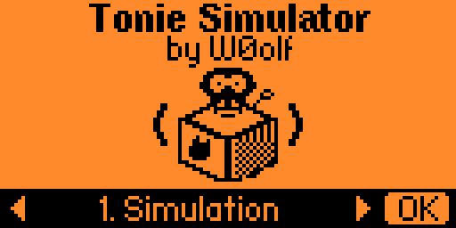
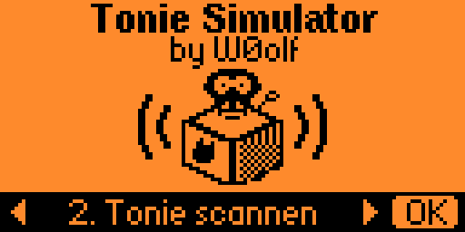
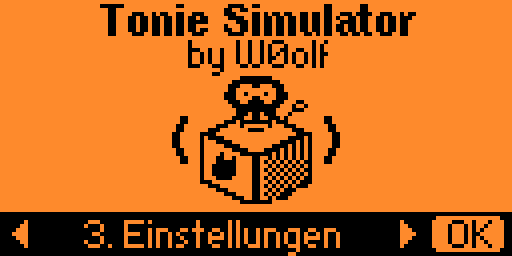
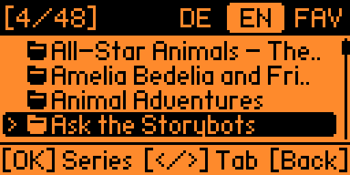
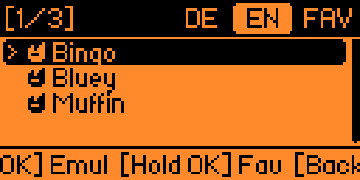
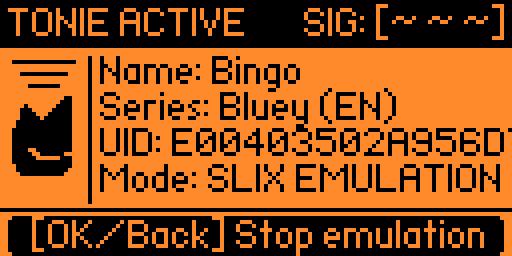
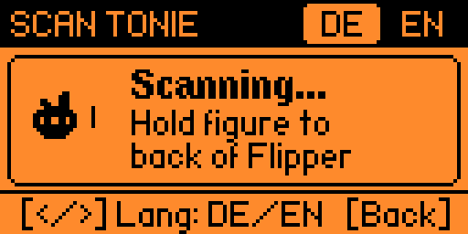
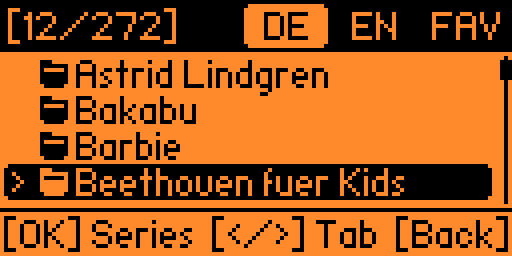
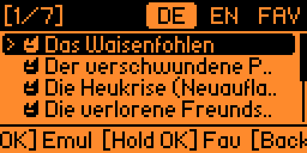
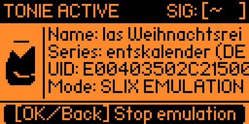

# Tonie-Simulator by W0olf

Flipper Zero application (`.fap`) for emulating and reading Toniebox NFC figures (ISO/IEC 15693, NXP ICODE SLIX and SLIX2).

**[English](#english) | [Deutsch](#deutsch)**

| Simulation | Scan Tonie | Settings |
| :---: | :---: | :---: |
|  |  |  |

---

## English

### Overview

Tonie-Simulator loads `.nfc` dumps from the Flipper Zero SD card, organizes them into German (`DE`), English (`EN`), and Favorites (`FAV`) tabs, and emulates the selected tag for a Toniebox. It also includes an NFC reader to scan physical Tonie figures and save them directly to a series folder on the SD card.

Key capabilities:
- **Two-level library browser**: Browse up to 350 series folders and 350 `.nfc` files per folder. Supports nested subfolders and filenames up to 255 characters.
- **Live NFC emulation**: Emulates NXP ICODE SLIX / ISO15693 tags with animated RF status, marquee title scrolling, 8-byte UID display, status LED, and haptic feedback.
- **Integrated NFC scanner**: Reads physical Tonie figures on the back of the Flipper Zero and saves them under an existing or newly created series folder.
- **Favorites and on-device settings**: Toggle favorites with a long press on `OK`. Configure the UI language (`DE` / `EN`), default startup tab, marquee scroll speed, vibration, and LED feedback in the settings menu.

### Screenshots

#### Browser & Emulation

| Series List (`EN`) | Tonies in Series (`EN`) | Live NFC Emulation |
| :---: | :---: | :---: |
|  |  |  |

#### NFC Scanner & Settings

| Waiting for Tonie | Tonie Detected | In-App Settings |
| :---: | :---: | :---: |
|  |  |  |

### SD Card Folder Structure

Place `.nfc` files on the Flipper Zero SD card using the directory layout below. Missing base directories and `tonie_simulator.cfg` are created automatically on first launch.

```text
/ext/nfc/flipper-zero-tonies/
├── tonie_simulator.cfg                  # Configuration and favorites (auto-generated)
└── tonies/
    ├── German/                          # DE tab
    │   ├── Benjamin Bluemchen/
    │   │   ├── 01_Wetterelefant.nfc
    │   │   └── 02_Rettet_den_Zoo.nfc
    │   └── Bibi Blocksberg/
    │       └── Hexen_gibt_es_doch.nfc
    └── English/                         # EN tab
        └── Bluey/
            ├── Bingo.nfc
            ├── Bluey.nfc
            └── Muffin.nfc
```

### Controls

| Screen | Button | Action |
| :--- | :--- | :--- |
| **Main Menu (Splash)** | `Left` / `Right` (or `Up` / `Down`) | Cycle between `1. Simulation`, `2. Scan Tonie`, `3. Settings` |
| **Main Menu (Splash)** | `OK` | Open selected menu item |
| **Main Menu (Splash)** | `Back` | Exit application |
| **Browser (Series / Files)** | `Up` / `Down` | Scroll list (wraps around at top and bottom) |
| **Browser (Series / Files)** | `Left` / `Right` | Switch tab between `DE`, `EN`, and `FAV` |
| **Browser (Series level)** | `OK` (short press) | Open selected series folder |
| **Browser (File level / FAV)** | `OK` (short press) | Start NFC emulation for selected Tonie |
| **Browser (File level / FAV)** | `OK` (long press) | Add or remove Tonie from Favorites (`*`) |
| **Browser (File level)** | `Back` | Return to series list (restores previous cursor position) |
| **Browser (Series level)** | `Back` | Return to Main Menu |
| **Live Emulation** | `OK` or `Back` | Stop NFC emulation and return to file list |
| **Scan Tonie** | `Left` / `Right` | Select target folder language (`DE` or `EN`) |
| **Scan Tonie (Tag Found)** | `OK` | Select or create a series folder and enter Tonie name |
| **Scan Tonie (Tag Found)** | `Up` / `Down` | Discard current read and scan again |

### Scanning a Physical Tonie Figure

1. Select `2. Scan Tonie` on the Splash screen and press `OK`.
2. Use `Left` or `Right` to choose whether the figure belongs to the `DE` (`German`) or `EN` (`English`) library.
3. Hold the Tonie figure flat against the back of the Flipper Zero until `TONIE FOUND!` appears with the 8-byte UID.
4. Press `OK` to open the series picker:
   - Choose `[+ Create new series]` at the top of the list to enter a new folder name, or
   - Select an existing series folder from the list.
5. Enter the Tonie name and confirm with `Save`. The `.nfc` file is written to `/ext/nfc/flipper-zero-tonies/tonies/<German|English>/<Series>/<Tonie>.nfc`.

### Installation

#### Option A: Download Release `.fap`
Download the `.fap` file matching your installed firmware (`tonie_simulator_momentum.fap`, `tonie_simulator_official.fap`, or `tonie_simulator_unleashed.fap`) from the [Releases](https://github.com/dev-w0olf/TonieSimulator/releases) page and copy it to `/ext/apps/NFC/tonie_simulator.fap` on your Flipper Zero using qFlipper or an SD card reader.

#### Option B: Build and Deploy from Source (`uFBT`)

1. Install `ufbt`:
   ```bash
   python3 -m pip install --upgrade ufbt
   ```
2. Select the SDK matching the firmware installed on your Flipper Zero:
   - **Momentum Firmware (Release)**:
     ```bash
     ufbt update --index-url=https://up.momentum-fw.dev/firmware/directory.json --channel=release
     ```
   - **Official Flipper Firmware (Release)**:
     ```bash
     ufbt update --index-url=https://update.flipperzero.one/firmware/directory.json --hw-target f7 --channel=release
     ```
   - **Unleashed Firmware (Release)**:
     ```bash
     ufbt update --index-url=https://up.unleashedflip.com/directory.json --channel=release
     ```
3. Connect the Flipper Zero via USB, close qFlipper, and run:
   ```bash
   ufbt launch
   ```
   This compiles `tonie_simulator.fap`, uploads it to `/ext/apps/NFC/tonie_simulator.fap`, and launches the app on the device.

### Configuration File (`tonie_simulator.cfg`)

Settings and favorites are stored in `/ext/nfc/flipper-zero-tonies/tonie_simulator.cfg`:

```ini
Filetype: TonieSimulator Config
Version: 1
# UiLanguage: DE or EN
UiLanguage: DE
# DefaultTab: German, English, or Favorites
DefaultTab: German
# ScrollSpeedMs: Marquee speed in ms (150 = Fast, 250 = Normal, 400 = Slow)
ScrollSpeedMs: 250
# Vibro: true or false
Vibro: true
# Led: true or false
Led: true
# Favorites: full SD card paths to .nfc files
Favorite: /ext/nfc/flipper-zero-tonies/tonies/German/Bibi Blocksberg/Hexen_gibt_es_doch.nfc
```

---

## Deutsch

### Überblick

Der Tonie-Simulator lädt `.nfc`-Dumps von der SD-Karte des Flipper Zero, sortiert sie in die Tabs Deutsch (`DE`), Englisch (`EN`) sowie Favoriten (`FAV`) und emuliert den gewählten Tag direkt für die Toniebox. Über den integrierten NFC-Scanner lassen sich außerdem echte Tonie-Figuren auslesen und direkt in einem Serien-Ordner auf der SD-Karte speichern.

Funktionsumfang:
- **Zweistufiger Serien-Browser**: Unterstützt bis zu 350 Serien-Ordner und 350 `.nfc`-Dateien pro Ordner inklusive verschachtelter Unterordner und Dateinamen bis 255 Zeichen.
- **Live-NFC-Emulation**: Emuliert NXP ICODE SLIX / ISO15693 Tags mit animierter Funkwellen-Anzeige, horizontalem Lauftext (Marquee), 8-Byte-UID, Status-LED und Vibrations-Feedback.
- **Integrierter NFC-Scanner**: Liest physische Tonie-Figuren über die Rückseite des Flipper Zero ein und speichert sie in einer bestehenden oder neu angelegten Serie.
- **Favoriten & Einstellungen am Gerät**: langes Drücken auf `OK` markiert Favoriten. In den Einstellungen lassen sich UI-Sprache (`DE` / `EN`), Start-Tab, Scroll-Tempo, Vibration und Status-LED anpassen.

### Screenshots

#### Browser & Emulation

| Serien-Auswahl (`DE`) | Tonies in Serie (`DE`) | Live-NFC-Emulation |
| :---: | :---: | :---: |
|  |  |  |

#### NFC-Scanner & Einstellungen

| Warten auf Tonie | Tonie erkannt | Einstellungen |
| :---: | :---: | :---: |
|  |  |  |

### Ordnerstruktur auf der SD-Karte

Lege die `.nfc`-Dateien in folgender Verzeichnisstruktur auf der SD-Karte ab. Fehlende Basisordner sowie die Datei `tonie_simulator.cfg` werden beim ersten Start automatisch erzeugt.

```text
/ext/nfc/flipper-zero-tonies/
├── tonie_simulator.cfg                  # Konfigurations- und Favoritendatei (automatisch erstellt)
└── tonies/
    ├── German/                          # Tab DE
    │   ├── Benjamin Bluemchen/
    │   │   ├── 01_Wetterelefant.nfc
    │   │   └── 02_Rettet_den_Zoo.nfc
    │   └── Bibi Blocksberg/
    │       └── Hexen_gibt_es_doch.nfc
    └── English/                         # Tab EN
        └── Bluey/
            ├── Bingo.nfc
            ├── Bluey.nfc
            └── Muffin.nfc
```

### Steuerung

| Ansicht | Taste | Aktion |
| :--- | :--- | :--- |
| **Hauptmenü (Splash)** | `Links` / `Rechts` (oder `Hoch` / `Runter`) | Zwischen `1. Simulation`, `2. Tonie scannen`, `3. Einstellungen` wechseln |
| **Hauptmenü (Splash)** | `OK` | Gewählten Menüpunkt öffnen |
| **Hauptmenü (Splash)** | `Back` | App beenden |
| **Browser (Serien / Dateien)** | `Hoch` / `Runter` | Durch die Liste scrollen (mit Sprung vom Ende zum Anfang) |
| **Browser (Serien / Dateien)** | `Links` / `Rechts` | Tab wechseln zwischen `DE`, `EN` und `FAV` |
| **Browser (Serien-Ebene)** | `OK` (kurz drücken) | Gewählten Serien-Ordner öffnen |
| **Browser (Datei-Ebene / FAV)** | `OK` (kurz drücken) | NFC-Emulation für den gewählten Tonie starten |
| **Browser (Datei-Ebene / FAV)** | `OK` (gedrückt halten) | Tonie als Favorit (`*`) hinzufügen oder entfernen |
| **Browser (Datei-Ebene)** | `Back` | Zurück zur Serien-Liste (merkt sich die vorherige Position) |
| **Browser (Serien-Ebene)** | `Back` | Zurück zum Hauptmenü |
| **Live-Emulation** | `OK` oder `Back` | NFC-Emulation stoppen und zurück zur Dateiliste |
| **Tonie scannen** | `Links` / `Rechts` | Ziel-Sprachordner (`DE` oder `EN`) wählen |
| **Tonie scannen (Erkannt)** | `OK` | Serie auswählen oder neu anlegen und Tonie-Namen vergeben |
| **Tonie scannen (Erkannt)** | `Hoch` / `Runter` | Aktuellen Scan verwerfen und neu scannen |

### Neue Tonie-Figur einlesen

1. Im Hauptmenü `2. Tonie scannen` wählen und mit `OK` bestätigen.
2. Mit `Links` oder `Rechts` auswählen, ob der Tonie unter `DE` (`German`) oder `EN` (`English`) gespeichert werden soll.
3. Die Tonie-Figur flach an die Rückseite des Flipper Zero halten, bis `TONIE ERKANNT!` samt 8-Byte-UID angezeigt wird.
4. `OK` drücken, um die Serien-Auswahl zu öffnen:
   - Ersten Eintrag `[+ Neue Serie anlegen]` wählen, um einen neuen Serien-Ordner per Texteingabe zu erstellen, oder
   - Einen vorhandenen Serien-Ordner aus der Liste auswählen.
5. Den Namen des Tonies eingeben und speichern. Die `.nfc`-Datei wird unter `/ext/nfc/flipper-zero-tonies/tonies/<German|English>/<Serie>/<Tonie>.nfc` abgelegt.

### Installation

#### Option A: Fertige Release-`.fap` kopieren
Lade die zur installierten Firmware passende Datei (`tonie_simulator_momentum.fap`, `tonie_simulator_official.fap` oder `tonie_simulator_unleashed.fap`) unter [Releases](https://github.com/dev-w0olf/TonieSimulator/releases) herunter und kopiere sie über qFlipper oder einen SD-Kartenleser nach `/ext/apps/NFC/tonie_simulator.fap`.

#### Option B: Aus dem Quellcode bauen und starten (`uFBT`)

1. `ufbt` installieren:
   ```bash
   python3 -m pip install --upgrade ufbt
   ```
2. SDK passend zur installierten Firmware auf dem Flipper Zero laden:
   - **Momentum Firmware (Release)**:
     ```bash
     ufbt update --index-url=https://up.momentum-fw.dev/firmware/directory.json --channel=release
     ```
   - **Offizielle Flipper Firmware (Release)**:
     ```bash
     ufbt update --index-url=https://update.flipperzero.one/firmware/directory.json --hw-target f7 --channel=release
     ```
   - **Unleashed Firmware (Release)**:
     ```bash
     ufbt update --index-url=https://up.unleashedflip.com/directory.json --channel=release
     ```
3. Flipper Zero per USB anschließen, qFlipper schließen und im Projektordner ausführen:
   ```bash
   ufbt launch
   ```
   Der Befehl kompiliert `tonie_simulator.fap`, kopiert die Datei nach `/ext/apps/NFC/tonie_simulator.fap` und startet die App direkt auf dem Flipper.
